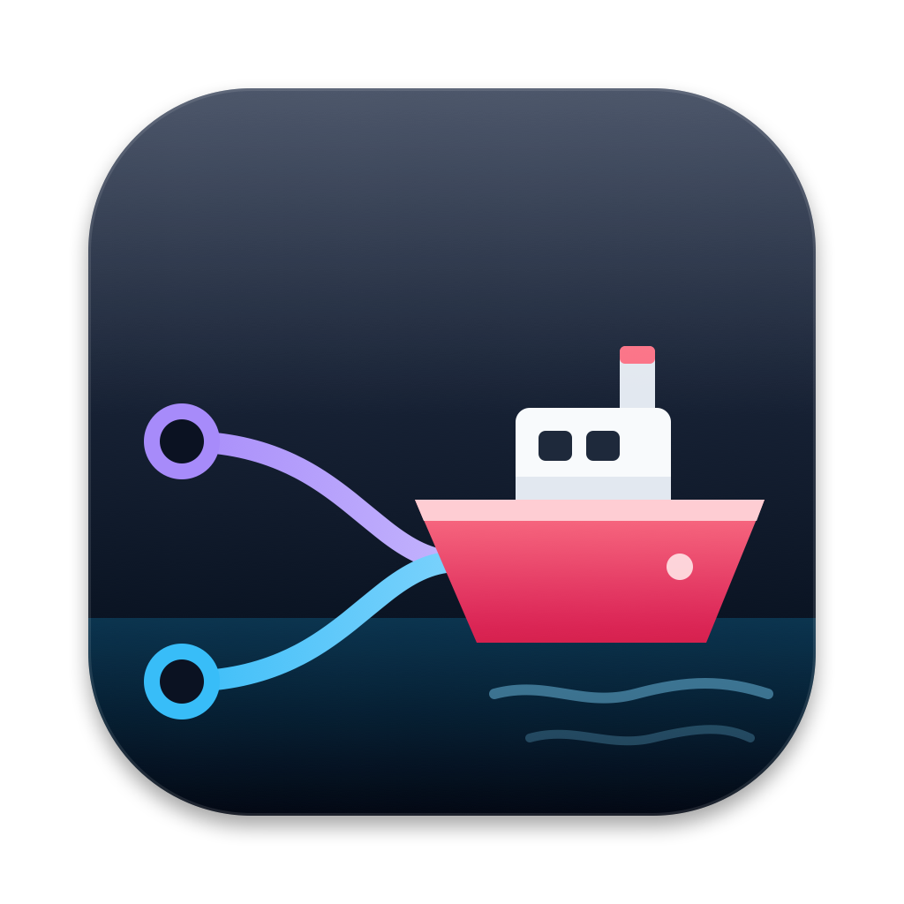
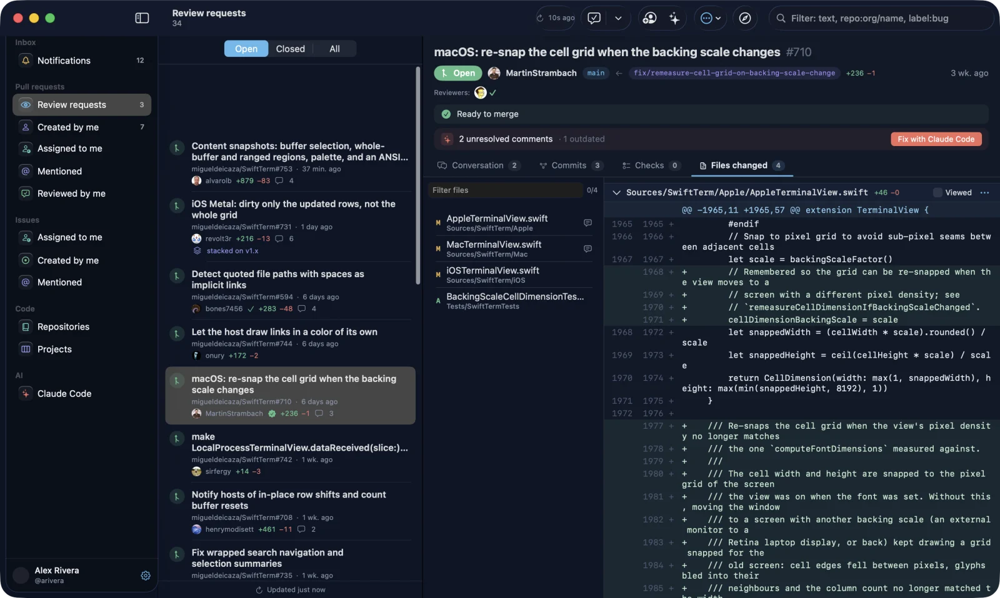

<p align="center">
  
</p>

<h1 align="center">Shipyard</h1>

<p align="center">
  <b>Pull requests, without the browser.</b><br>
  A tiny native macOS client for GitHub, with a built-in Claude Code workspace.
</p>

<p align="center">
  <a href="https://github.com/Vaache/shipyard/releases/latest/download/Shipyard.dmg"><b>Download for macOS</b></a>
  ·
  <a href="https://vaache.github.io/shipyard/">Website</a>
  ·
  <a href="https://github.com/Vaache/shipyard/releases">Releases</a>
</p>

<p align="center">
  
</p>

---

A browser tab with GitHub can use a gigabyte of memory just to show one diff. Shipyard is a SwiftUI app that handles the daily review work: it opens instantly, scrolls huge diffs smoothly and sends review feedback straight to Claude Code.

## Features

**Pull requests**
- Review requests, your PRs and everything you're involved in, with filters by state
- Conversation, review threads, commits, checks and changed files
- Comment, approve, request changes and merge
- Fast diff viewer with sticky file headers, built on `NSTableView`
- Stacked pull requests: the whole stack in the PR header, jump up and down the chain, "stacked on" markers in lists

**Everything else you open GitHub for**
- Notifications and issues
- Repositories with a file browser and syntax highlighting
- GitHub Projects boards
- Menu bar badge with the number of pending review requests
- Shipyard theme in light and dark, or the native macOS look
- Open any GitHub link inside the app (`⌘L`)
- Built-in updates: **Shipyard → Check for Updates…** downloads and installs new releases

**Claude Code workspace**
- Native chat for the official Claude Code CLI, next to the PR, changed files and branch
- **Fix with Claude Code**: one click sends review feedback to a new session. Uses the reviewer's "Fix prompt" if there is one, or composes it
- Session history grouped by project, with the branch and the PR each session opened
- Switch model, effort and permission mode, approve tool calls inline, see a diff of every edit
- Idle sessions sleep and free their memory, then resume on the next message
- Context and plan usage overlay
- Multiple Claude accounts (for example personal and work) with separate sign-ins and history
- Classic terminal mode if you prefer the CLI UI

## Install

1. Download [`Shipyard.dmg`](https://github.com/Vaache/shipyard/releases/latest/download/Shipyard.dmg) (universal: Apple Silicon and Intel).
2. Open it and drag **Shipyard** to Applications.
3. The app is not notarized yet, so macOS blocks the first launch. Open **System Settings → Privacy & Security → Open Anyway** (the DMG includes a *How to Install* guide), or run:

   ```bash
   xattr -dr com.apple.quarantine /Applications/Shipyard.app
   ```

After that, updates install from inside the app: **Shipyard → Check for Updates…**

**Requirements:** macOS 14 Sonoma or later. Optional: [GitHub CLI](https://cli.github.com) for one-click sign-in, [Claude Code](https://docs.claude.com/en/docs/claude-code) for the Claude workspace.

## Sign in to GitHub

Pick one on the welcome screen:

- **GitHub CLI**: uses the token from `gh auth login`.
- **Personal access token**: classic token with `repo`, `read:org`, `notifications`, `workflow`, and `read:project` / `project` for Projects.
- **Device Flow**: enter the Client ID of your own [GitHub OAuth App](https://github.com/settings/developers) with Device Flow enabled.

The token is stored in the macOS Keychain.

## Privacy

Shipyard has no backend and no analytics. It talks directly to `api.github.com` and runs your locally installed `claude` CLI. It never reads your Claude credentials: sign-in goes through `claude auth login` in your browser.

## Build from source

Requires Xcode 15.3+ (Swift 5.10).

```bash
git clone https://github.com/Vaache/shipyard.git
cd shipyard
./scripts/build.sh            # builds build/Shipyard.app
./scripts/build.sh --install  # builds and copies it to /Applications
```

Other scripts:

- `UNIVERSAL=1 ./scripts/build.sh`: universal binary (arm64 + x86_64)
- `./scripts/release.sh 2.1.0`: universal build packed into `build/Shipyard-2.1.0.dmg` with a drag-to-Applications window (needs `pip3 install --user dmgbuild`; Finder applies the background so it also shows on macOS 26)
- `swift scripts/make_icon.swift Resources/Brand/icon.svg build/AppIcon.iconset`: regenerate the icon

The build is signed with the first "Apple Development" identity in your keychain, or ad-hoc if there is none. Set `SIGN_ID` to choose another one.

Read-only API self test:

```bash
swift build -c release
SHIPYARD_TOKEN=$(gh auth token) .build/release/Shipyard --selftest
```

Screenshots without personal data: `SHIPYARD_DEMO_REPO=owner/name` lists a public repository in every pull request and issue section and shows a placeholder user; `SHIPYARD_DEMO_FOLDER=/path` limits the Claude Code history to that folder.

### Project layout

```
Sources/Shipyard/
  App/        app entry, routing, settings, deep links (shipyard://)
  API/        GitHub GraphQL + REST client and models
  Auth/       sign-in flows, Keychain
  Features/   PR, Lists, Issue, Repos, Projects, Notifications, MenuBar, Claude, ClaudeFix
  Shared/     diff table, HTML view, tab strip, localization, utilities
docs/         website (GitHub Pages)
```

## Acknowledgements

- [SwiftTerm](https://github.com/migueldeicaza/SwiftTerm) by Miguel de Icaza, MIT License, powers the terminal mode.

## License

[MIT](LICENSE)

Shipyard is an independent project and is not affiliated with or endorsed by GitHub, Inc. or Anthropic. GitHub and Claude are trademarks of their respective owners.
